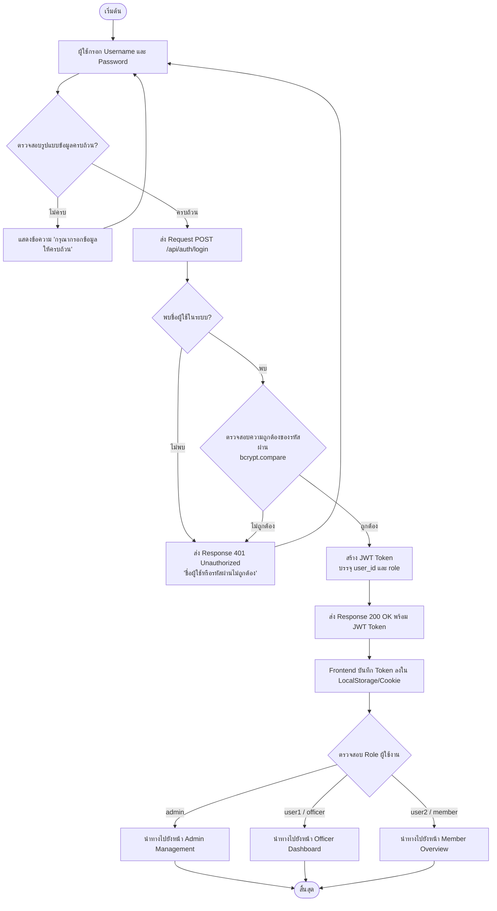
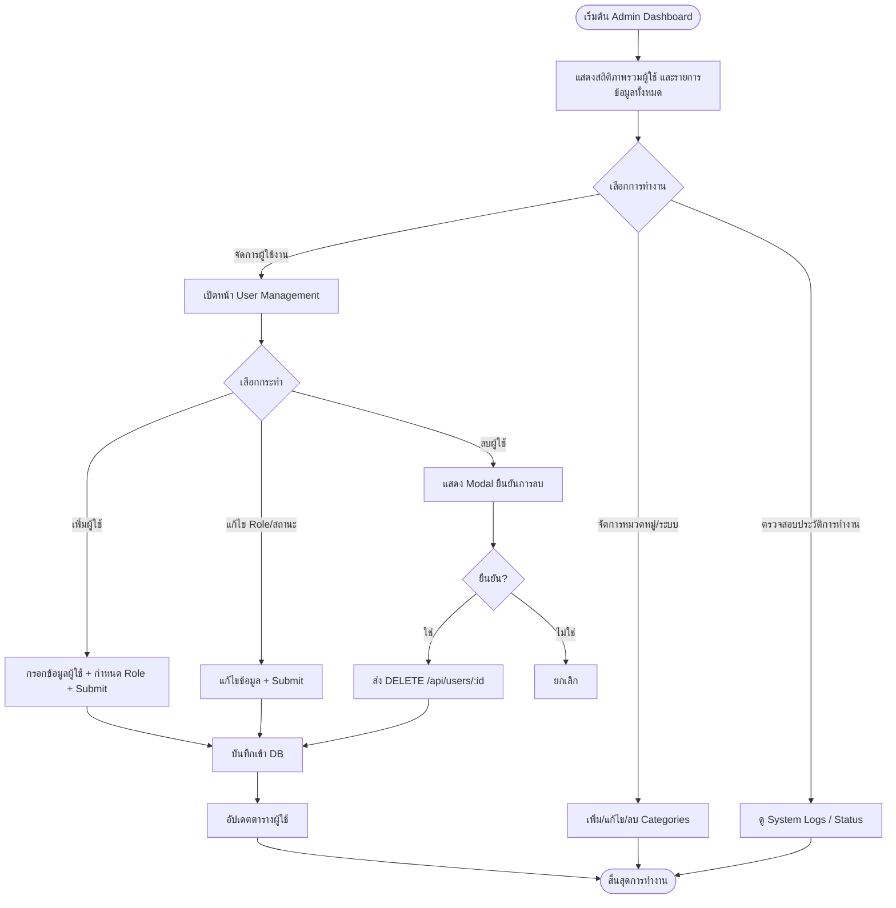
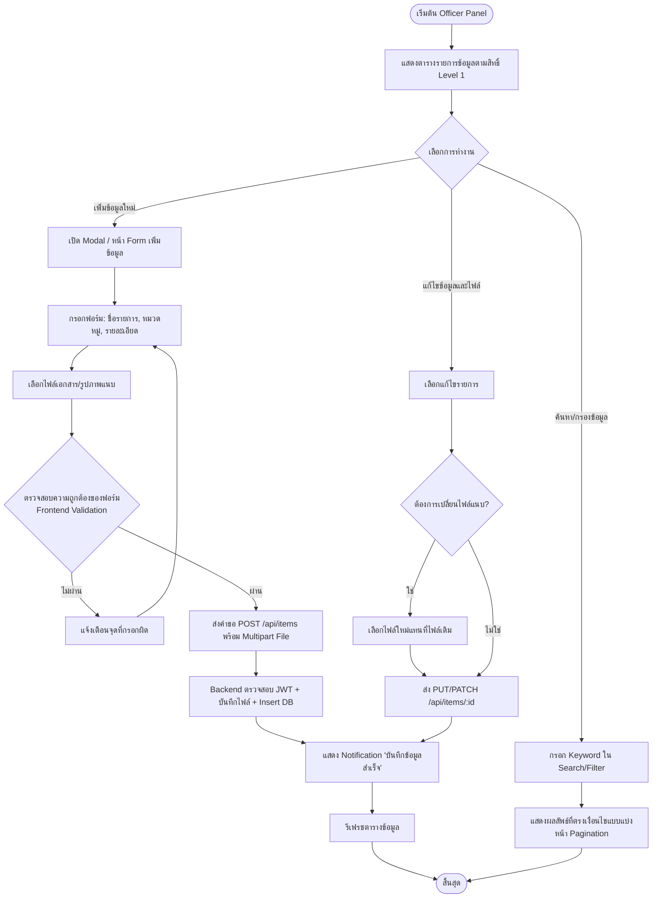
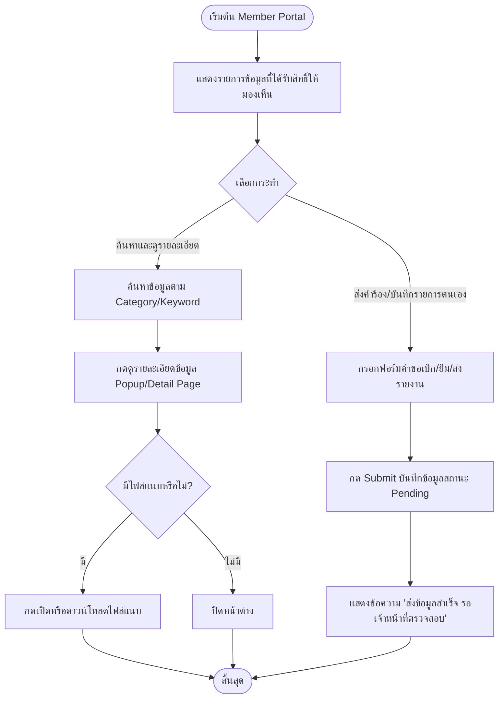
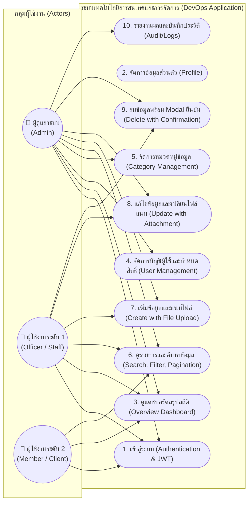
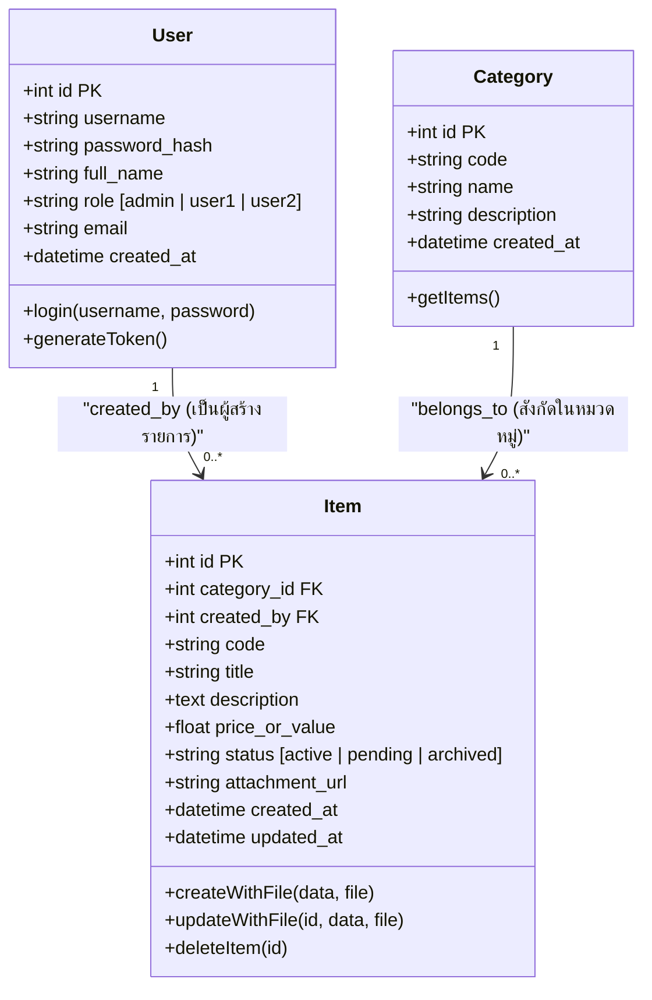

# 📐 แผนผังระบบ (Flowcharts, Use Case & Class Diagram)
**เกณฑ์ข้อ 4.1 และ 4.2 (คะแนนเต็ม 5 + 5 คะแนน)**

ไฟล์นี้รวบรวม Diagram ครบตามโจทย์ สามารถนำโค้ด Mermaid ด้านล่างไป Import หรือวาดลงใน **Draw.io (Offline)** ได้ทันทีในการแข่งขัน

---

## 1. Flowchart ระบบการเข้าสู่ระบบ (Login Flow)
*เกณฑ์: จัดทำผังงานระบบการเข้าสู่ระบบ (Login Flow)*

---

## 2. Flowchart กระบวนการของผู้ดูแลระบบ (Admin Process)
*เกณฑ์: จัดทำผังงานกระบวนการของผู้ดูแลระบบ (CRUD ผู้ใช้, หมวดหมู่, อนุมัติข้อมูล, ดู Audit Log)*

---

## 3. Flowchart กระบวนการของผู้ใช้งานระดับ 1 (User Level 1 / Officer)
*เกณฑ์: จัดทำผังงานกระบวนการของผู้ใช้งานระดับ 1 (เจ้าหน้าที่: เพิ่มรายการ, อัปโหลดไฟล์, แก้ไขข้อมูล)*

---

## 4. Flowchart กระบวนการของผู้ใช้งานระดับ 2 (User Level 2 / Member / General User)
*เกณฑ์: จัดทำผังงานกระบวนการของผู้ใช้งานระดับ 2 (ผู้ใช้งานทั่วไป: ดูข้อมูล, ค้นหา, ส่งคำขอ)*

---

## 5. ผังงานภาพรวมของระบบทั้งหมด (Use Case Diagram)
*เกณฑ์: จัดทำผังงานภาพรวมของระบบทั้งหมด (Usecase Diagram)*

---

## 6. โครงสร้างฐานข้อมูลเชิงสัมพันธ์และ Class Diagram
*เกณฑ์: ออกแบบฐานข้อมูลอย่างน้อย 3 ตาราง, มีความสัมพันธ์ Relational, Data Type เหมาะสม, Class Diagram สมบูรณ์*

